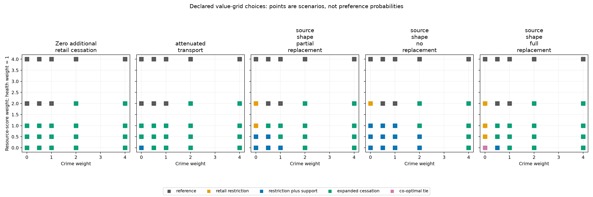
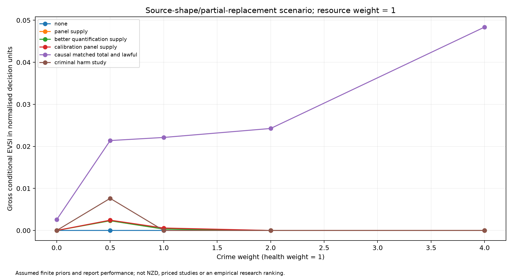

# Conditional policy and information choices under value disagreement

Working manuscript and executed analysis report, 28 October 2026. This document is
not submitted. Authorship, institutional requirements, journal selection and final
submission approval remain author matters. The ethics assessment is documentary,
not a formal exemption, approval or cultural endorsement.

## Abstract

**Objective.** Examine whether policy and information priorities remain stable when
value judgments change, holding empirical assumptions fixed, in a conditional
model of tobacco-retail regulation.

**Methods.** Five existing finite structural/prior cases were crossed with 25
analyst-selected crime and resource-score weight profiles, with health weight fixed
at one. Four actions were compared using expected utility. Expected value of perfect
information (EVPI), grouped expected value of partial perfect information (EVPPI),
expected value of sample information (EVSI) and target-specific expected information
gain (EIG) were computed using existing finite enumeration. Affine expected-value
comparisons provided continuous weight-box robustness certificates and switching
thresholds. Public-source eligibility and provenance were checked without fitting
new target likelihoods. Numerical grids with 2, 4 and 8 cessation nodes were compared.

**Results.** Under one unchanged structural/prior case, each of the four actions was
optimal at a different declared value profile. No action was co-optimal throughout
the complete weight rectangle in any of the five cases. Gross information rankings
also changed with the objective. Information about a latent quantity could remain
positive while its decision value was zero. Refinement from four to eight nodes
changed no policy, gross-EVSI design or grouped-EVPPI co-optimal set at the declared
profiles, although numerical information values changed slightly.

**Conclusion.** Within this model, factual uncertainty alone does not determine policy
or information priorities. Value assumptions must be reported and challenged alongside
empirical assumptions. These are conditional mathematical findings, not estimates
of an implemented NZ policy effect, societal preferences or a funded study choice.

## Research question and scope

The question is: under what empirical/structural assumptions and value trade-offs do
retail restriction, restriction with support, expanded cessation or the reference
remain preferred, and what information could change that comparison?

The applied discussion concerns a hypothetical approximately 600-retailer NZ
contrast and residents aged 15+ using cigarettes or roll-your-own. The numerical
model uses a synthetic representative catchment and an all-resident exposure
denominator; transport to that target is unqualified. Native exposure is a daily
rate per 1,000 residents. A first-year response is considered, not lifetime health
benefits. No deaths, QALYs, national illicit total or NZ-dollar budget is estimated.
The analysis does not establish current legal deliverability or agency endorsement.

The original issue #3 empirical milestone remains open. A conditional modelling
article and an empirical causal policy evaluation have different claim requirements.
This report addresses the former without relabelling its assumptions as observations.

## Evidence and parameter construction

The earlier bounded public map contains 35 document records and 213 candidate
screening dispositions; those counts are neither independent-study counts nor a
claim of exhaustive systematic review. The [source tables](../../evidence/m2/public_sources_20261027/README.md)
retain inaccessible originals, unverified extracts, funding interests and repeated
underlying data. In the current analysis all 82 mapped extracts remain unadopted as
target observations or likelihoods. Source roles are exported in
[source_use.csv](../../results/m2_publication_20261028/source_use.csv).

The inherited cessation shape, Beta(23.4,97.2), is separately rechecked against
Table 2 of [the source simulation study](https://doi.org/10.1136/tc-2022-057655).
That input combines earlier modelling and stated quitting intentions. It concerns
a different outlet reduction and horizon, not an observed efficacy estimate for
the current target. The existing null/attenuation scenarios and equal-intensity
consumption mapping are retained. A newly saved full original improves provenance;
it does not create another empirical observation or justify a new posterior.

All other state supports, conditional state probabilities, consequence mappings,
resource scores and report-performance assumptions retain their existing declared
roles. The [parameter provenance table](../../evidence/m2/publication_20261028/parameter_provenance.csv)
links them to their configuration fields. The public human-yield and wastewater
studies do not supply a jointly qualified raw-sewage conversion, product mixture,
shared error structure or NZ policy response. Historical funding, fees and excise
records are not used to calibrate current real-resource costs. Shared MOH/NZHS and
biological calibration inputs are not conditioned on again.

## Analysis methods

The dated [protocol](M2_PUBLICATION_PROTOCOL.md) distinguishes earlier work, the first
pilot and implementation amendments. It is not a preregistration.

The objective is U=H−wC C−wR R. H is a normalised health-consequence score, C is signed
incremental criminal harm, and R is an illustrative real-resource score. Fiscal
volume changes are reported separately; tax transfers are not added as social
resource costs. Health weight is one. Crime and resource weights independently
take values 0, 0.5, 1, 2, 4: zero to four times the reference weight is an illustrative
stress support, not measured preference uncertainty. No probabilities are assigned
to value profiles or competing structural cases. Additive weighting does not cover
all ethical positions, nonlinear objectives, rights constraints or hard budgets.

The five cases retain null or attenuated cessation transport and alternative lawful
replacement assumptions. The inherited identifier null_effect means zero additional
retail cessation; diversion and support responses remain modelled. It does not mean
that every policy consequence is zero. Zero marginal criminal harm remains an
empirical-state assumption separate from choosing a zero weight on crime.

All numerically co-optimal actions are retained at absolute tolerance 1e-11. At each
of the 125 case/value profiles, seven existing finite partitions are evaluated for
EVPPI before six hypothetical report designs are evaluated for EVSI. The partitions
overlap and their values are not additive. The no-information comparator is retained.
Causal report channels presuppose identification that baseline wastewater does not
provide. Report performance, implementation and use of information are assumed.

EVSI is gross expected decision improvement before study costs. Its break-even ceiling
is in the same objective units, not a supplier price or NZD budget. Any study cost
must first be mapped to that objective. A strictly positive cost can make a zero-EVSI
study inferior to no study. No raw resource-cost ceiling is obtained by dividing by
a zero resource weight, and no study is commissioned or sample size optimised.

EIG about net cessation, diversion and the criminal-harm coefficient is reported in
nats. For fixed prior, target and report likelihood, EIG does not depend on utility
weights. This does not imply that the preferred information design is value-neutral.

Pairwise expected-value differences are affine in the two normative weights. An
action co-optimal at all four vertices of the rectangle is therefore co-optimal
over its complete continuous interior. These certificates hold only under the stated
prior, structure and additive objective. Isolated crime-weight upper-envelope ties
are calculated analytically at fixed resource weights; dominated-action intersections
are excluded. Persistent ties are not invented isolated thresholds.

### Construction details and complete configuration links

The axis table lists the retained base axes: the original `restriction` axis is
replaced by `net_cessation`. For n cessation nodes, the non-null supports are
`transport × BetaQuantile((j + 0.5)/n; 23.4, 97.2)`, j = 0,...,n−1. The explicit
zero receives `null_weight`; each other node receives `(1−null_weight)/n`.
Duplicate supports are combined and zero-mass supports removed. Every other retained
axis and the additional policy-supply multiplier use independent uniform finite
weights. Their Cartesian product is normalised. This independence and each
case's null mass are assumptions, not estimated covariance or scenario probabilities.
The [five case records](../../configs/m2_retail.json) supply transport, null mass and
lawful replacement; [the constructor](../../src/tobac/retail_case.py) is the executable
formula reference. Earlier alternative M1 prior/dependence scenarios are not silently
pooled into these M2 cases.

| Construction | Binding and values | Role and limit |
| --- | --- | --- |
| Scale | [regulatory config](../../configs/regulatory.json), `reference_exposure = 1000` | Normalisation only; not a monetary exchange rate. |
| Catchment and biomarker constants | Same config, `constants`: population 1000; flow 200 L/person/day; nicotine 0.9 mg/cigarette; recovery 0.74; anabasine survival 0.85 | Inherited illustrative mappings; target calibration remains open. |
| Post/counterfactual lawful-supply bias | [retail constructor](../../src/tobac/retail_case.py), `policy_supply_ratio = [0.85, 1.15]`, equal mass | Additional assumed measurement axis. |
| Baseline reports | Regulatory config, `measurements`: anabasine cuts [2,4] ng/L; improved [0.5,2,4]; nicotine [3000,6500] ng/L; lawful supply [300,600] cigarettes/1000/day | Coarsened hypothetical reports, not real assay performance. |
| Error and calibration | Same fields: baseline log SD 0.35, supply 0.2, calibration 0.1; yield cuts [0.8,1.0] µg/cigarette | Lognormal bin probabilities; finite yield axis remains an assumed ±25% support. |
| Causal total-consumption report | Same fields: post/counterfactual ratio cuts [0.7,0.9], log SD 0.12 | Requires a causal counterfactual; a national release ratio does not identify it. |
| Causal lawful-consumption report | Retail channel: cuts [0.2,0.5,0.8], log SD 0.2, multiplied by policy-supply bias | Joint total/lawful report is assumed conditionally independent given states. |
| Criminal-harm report | Regulatory `harm_classification_accuracy = 0.8` | Binary assumed classification of high/low coefficient, not an empirical crime assay. |
| Design combinations | [study definitions](../../src/tobac/regulation.py) and retail extension | Baseline panel combines anabasine/nicotine/supply; better quantification replaces the first channel; calibration adds the calibration channel; none is one uninformative report. Conditional independence given states is assumed. |

For baseline total T and illicit I, lawful L = T−I. After additional retail
cessation q, diversion is D = L(1−q)d, lawful volume Lr = L(1−q)−D, and illicit
volume Ir = I(1−q)+D. Support removes M = Ir m from illicit supply and replaces a
fraction r lawfully, giving Lr+Mr and Ir−M. Expanded cessation multiplies both
baseline streams by (1−c). Health score is h(T−total)/1000; criminal-harm change
is k(illicit−I)/1000. Resource scores are the declared fixed action scores. These
are the existing mappings; the new analysis changes weights, not their equations.

Under prior p, EVPI is E[max_a U(a,s)]−max_a E[U(a,s)]. Grouped EVPPI conditions
on the declared finite partition before maximising; EVSI conditions on each
hypothetical report using its state likelihood, then averages over reports.
All use the same prior and objective. The posterior computations represent
hypothetical future learning, not conditioning on new observed evidence. The
[shared finite implementation](../../src/tobac/information.py) retains the scalar
reference oracle and posterior-martingale checks. EIG is the reduction in target
entropy averaged over those reports, with the natural logarithm.

## Results

The complete primary outputs contain 20 action-consequence rows, 125 value profiles,
875 grouped-information rows, 750 study-value rows, 90 target-information rows and
19 switching points. These are enumerated model outputs, not sample sizes.
[Machine-readable report and grid diagnostics](../../results/m2_publication_20261028/report.json).

### Policy choices depend on values even with identical factual assumptions

The following rows use the same source_shape_partial_replacement case and the same
state probabilities. Only value weights change; health weight remains one.

| Crime weight | Resource weight | Co-optimal action |
| ---: | ---: | --- |
| 0 | 0 | Restriction with support |
| 0 | 1 | Retail restriction |
| 1 | 1 | Expanded cessation |
| 0 | 4 | Reference |

These profiles demonstrate dependence on declared values, not which values should
be adopted. They are not population preference estimates. With resource weight one,
the primary-grid retail-restriction/expanded-cessation switch occurs at a crime
weight of approximately 0.3294. This is a constructed threshold within the finite
model, not an empirically estimated social threshold or confidence limit.

The continuous-box co-optimal set is empty in each structural case and across their
intersection. Thus no single action is certified as expected-utility optimal across
the complete declared rectangle. This is not a claim that the actions are ineffective
or that no decision can be made under a specified objective.



Figure 1. Points are evaluated analyst profiles, not preference probabilities or
continuous coloured decision regions. Grey denotes the reference; pink denotes
co-optimality. The null-cessation panel does not remove all other policy pathways.
[Vector figure](../../results/m2_publication_20261028/decision_grid.svg).

### Gross information priorities also depend on values

In the same source-shape/partial-replacement case, at crime/resource weights 1/1,
the matched total-and-lawful causal report has the largest gross EVSI among the
six declared designs: approximately 0.02212 normalised decision units. At weights 0/4,
the calibration-plus-panel-and-supply report has the largest gross EVSI, approximately
0.01374. These are conditional gross-information rankings, not net study benefits.
Actual costs, feasibility and empirical report performance are not established.

A separate attenuated-transport case at weights 0.5/0 gives the criminal-harm report
gross EVSI of approximately 0.004311, above approximately 0.002309 for the matched causal
report. Both structural assumptions and values matter; this cross-case example is
not attributed solely to a change in preferences.

The criminal-harm report carries approximately 0.1927 nats about the finite crime
coefficient in the source-shape/partial-replacement case. At crime weight zero its
EVSI is zero despite that positive EIG. Learning a quantity and learning something
that changes an action are distinct outcomes under a specified objective.



Figure 2. A selected, explicitly labelled structural case with resource weight one.
Points are evaluated profiles; connecting segments are visual guides, not a calculated
continuous EVSI frontier. Source assumptions and report performance are hypothetical.
All cases remain available in the tables; the displayed slice is not a selected empirical
best fit. [Vector figure](../../results/m2_publication_20261028/study_value_slice.svg).

### Numerical resolution

At all 125 profiles, policy co-optimal sets are unchanged for 2→4 and 4→8 nodes. One
co-optimal gross-EVSI design set changes from 2 to 4 nodes at a near-zero-value comparison;
none changes from 4 to 8. Grouped-information co-optimal sets do not change on either
refinement. For 4→8, the largest absolute EVPI, EVPPI and EVSI differences are approximately
0.0003123, 0.0003900 and 0.0002949 normalised decision units, respectively. These diagnostics
do not prove continuous convergence, identical continuous switching frontiers or field
validity. Full-precision values are retained in the report and child-grid outputs.

## Discussion and limits

The model illustrates why a research priority cannot be presented independently of
the objective and assumed causal/reporting structure. Positive information gain may
have no action value; gross information value may not exceed real study costs; and
additional factual precision cannot settle every normative disagreement. These are
conditional implications, not claims about observed NZ decision-maker preferences.

The underlying empirical gaps remain substantial: matched consumption/lawful supply,
stock/visitor adjustments, target-compatible assay recovery and biological calibration,
policy-induced diversion and mitigation, incremental criminal harms and current resource
costs are not jointly identified. Existing public reports constrain interpretation
and applicability rather than furnishing a fitted national posterior. Historical
release predictions do not validate the unobserved target-policy response.

No Māori-specific distributional effects are estimated and no Māori or societal values
were elicited. National averages cannot establish equity or community endorsement.
The limited additive objective and weight rectangle do not encompass every relevant
value or constraint. Wider supports, alternative priors, other causal pathways or actual
cost information may change conclusions. Numerical tests and a source catalogue do
not substitute for external scientific validation or ethics review where required.

## Ethics, transparency and publication readiness

The [desk assessment](M2_PUBLICATION_ETHICS.md) records public-source use and synthetic
model scenarios, with no recruitment, tissue collection or identifiable-health-record
access or external linkage. It does not establish formal HDEC/institutional exemption,
ethics approval, cultural review or endorsement. Appropriate institution, site and journal
requirements remain undetermined. If formal review applies, it must be addressed
prospectively before in-scope work; no retrospective approval is assumed.

No request,application,registration or journal submission was made. The analysis
plan, code, parameter roles, source URLs/hashes and generated tables/figures are versioned.
All numerical inputs used here are explicit configurations or inherited model inputs;
raw source documents are held locally and catalogued, not claimed present in a clean
checkout merely because their hashes are recorded. Source-access limitations remain.
Funding, conflicts, authorship and journal-specific disclosure fields require author
confirmation; none is invented. Applicable CHEERS 2022 items guide transparent reporting,
not a claim of methods certification. [Reporting guidance](https://www.ispor.org/heor-resources/good-practices/cheers).

## Reproduction

Use the qualified repo-local Python 3.15.1 environment and the existing bounded runner:

```
OPENBLAS_NUM_THREADS=1 MPLBACKEND=Agg .nox/tests/bin/python scripts/run_bounded.py \
  --timeout 2400 -- .nox/tests/bin/python scripts/run_m2_publication.py \
  --out outputs/publication-reproduction-NEW --grid-check
```

The output must be new; nonempty output directories are refused. Nox reproduce runs the same
primary and resolution analysis alongside the existing M1/M2/M3 and longitudinal
checks. Each run binds actual source, configuration and output hashes. Primary execution
is recorded in results/m2_publication_20261028/manifest.json; the report identifies
the computational commit separately from later manuscript/Conductor commits.
